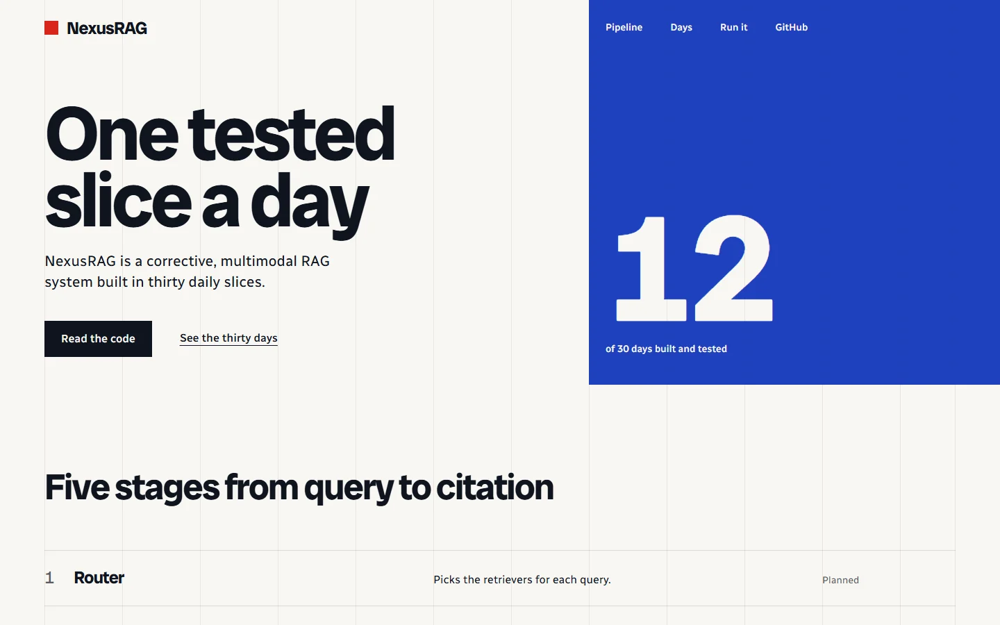

<h1 align="center">NexusRAG</h1>

<p align="center"><strong>A production-oriented corrective, multimodal RAG system, built one tested slice a day.</strong></p>

<p align="center">
A 30-day build combining LangGraph orchestration, corrective retrieval with sentence filtering,
hybrid dense and sparse search on Qdrant, FastAPI, RAGAS evaluation and LangSmith tracing.
Each day adds one tested vertical slice.
</p>

<p align="center">
  <a href="https://github.com/boss477/NexusRAG/actions/workflows/tests.yml"></a>
  <a href="LICENSE"></a>
  
  <a href="docs/30-day-plan.md"></a>
  <a href="https://boss477.github.io/NexusRAG/"></a>
</p>

<p align="center"><a href="https://boss477.github.io/NexusRAG/"></a></p>

<sub>The project page, with the pipeline, the thirty days and the quick start.</sub>

## What runs today

| Stage | What it does | Built |
|---|---|---|
| **Foundation** | FastAPI app, typed settings, JSON logging, request IDs, health and readiness endpoints | Days 1 to 3 |
| **Ingestion** | TXT, Markdown, PDF and DOCX loaders with page citations, sentence-aware chunking | Days 4 and 5 |
| **Embeddings** | A provider interface, Gemini Embedding 2 and local EmbeddingGemma 2 | Days 6 to 8 |
| **Semantic search** | Indexing and search on Qdrant | Day 9 |
| **Keyword search** | BM25 on SQLite FTS5 | Day 10 |
| **Fusion** | Reciprocal Rank Fusion over dense and sparse results | Day 11 |
| **Reranking** | A cross-encoder over the fused candidates | Day 12 |

Next: LangGraph state, the router agent, corrective grading, generation and grounding. The full
plan is in [docs/30-day-plan.md](docs/30-day-plan.md).

## Planned architecture

```text
Query -> Router -> Hybrid Retrieval -> Correction -> Generation
                                      ^              |
                                      |              v
                              Web fallback <- Reflection -> Grounding
```

## 30-day roadmap

The detailed plan is in [docs/30-day-plan.md](docs/30-day-plan.md). Days 1 to 12 are complete and published.

## Quick start

```bash
python -m venv .venv
# Windows: .venv\Scripts\activate
# Linux/macOS: source .venv/bin/activate
pip install -e ".[dev]"
copy .env.example .env       # Windows
# cp .env.example .env       # Linux/macOS
uvicorn app.main:app --reload
```

Open http://localhost:8000/docs.

## Current status

Days 1 to 12 are complete: ingestion, embeddings, semantic and keyword retrieval, RRF fusion, and reranking. Day 12 is documented in [docs/day-12-rerank.md](docs/day-12-rerank.md).

Decisions are recorded in [docs/](docs/).

## Tests

```bash
pip install -e ".[dev,qdrant]"
pytest
```

The reranker tests inject a fake scorer and download no weights.

## Contributing and license

See [CONTRIBUTING.md](CONTRIBUTING.md). NexusRAG is released under the [MIT License](LICENSE).
